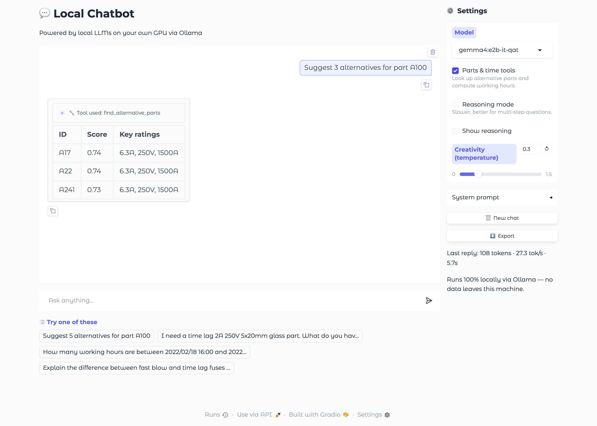
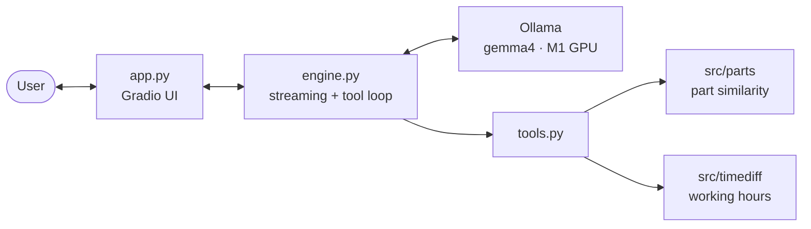

<div align="center">

# 💬 Local LLM Chatbot

**A private, GPU-accelerated chatbot that runs entirely on your own machine and can look up parts and compute working hours.**




</div>

## ✨ Features

- **100% local.** It runs `gemma4:e2b` through Ollama on the Apple M1 GPU at ~30 tokens/s, and no data leaves the machine.
- **Tool calling.** The model calls tested Python functions instead of guessing:
  - find alternative parts by ID or by description;
  - compute (working) hours between two timestamps.
- **Transparent.** Every tool call appears in the chat with its arguments and raw result.
- **Easy to use.** Streaming answers, example prompts, model picker, reasoning mode, Markdown export.
- **Data science modules included:**
  - binary classifier (F1 0.93 on the minority class);
  - part-similarity search with a descriptive analysis.

## 🏗️ Architecture



## 🚀 Quick start

**Prerequisites:** Python 3.11+ and [Ollama](https://ollama.com).

```bash
# 1. Install
python3.11 -m venv .venv && source .venv/bin/activate
pip install -r requirements.txt

# 2. Get the model
ollama pull gemma4:e2b-it-qat

# 3. Add the datasets (see data/README.md)
cp /path/to/{table_1,table_2,Parts}.csv data/

# 4. Run
python app.py        # → http://127.0.0.1:7860
```

## 🧩 What's inside

| Component | Description | Run |
|---|---|---|
| **Chatbot** | Local LLM chat app with tools | `python app.py` |
| **Classification** | Predict `Type` from two joined tables | `python -m src.classification.train` |
| **Similar parts** | 5 alternatives per part from `DESCRIPTION` | `python -m src.parts.find_alternatives` |
| **Hours** | Rounded hours between two timestamps | `from src.timediff import hours_between` |
| **Working hours** | Same, 09:00–17:00 on weekdays only | `from src.timediff import business_hours_between` |

## 📊 Highlights

| | Result |
|---|---|
| Chatbot speed | **~30 tok/s**, 100% GPU offload on an Apple M1 (8 GB) |
| Classifier | Random forest: **PR-AUC 0.97**, **F1 0.93** for the rare class, 0 false positives |
| Part matching | Hybrid TF-IDF + current rating: **0.69** rating agreement vs 0.48 for text only |

## 📁 Project structure

```
app.py               Gradio chatbot
src/chatbot/         chat engine + LLM tools
src/classification/  binary classifier
src/parts/           part similarity search
src/timediff/        (working) hours
reports/             generated results
tests/               pytest suite
docs/                full documentation, diagrams, screenshots
```

## 🧪 Tests

```bash
pytest               # 33 tests, no GPU or Ollama needed (part-search tests skip without the data)
```

## 📖 Documentation

The full write-up is in **[docs/DOCUMENTATION.md](docs/DOCUMENTATION.md)**. It covers:
- the architecture and request flow;
- the machine specs;
- why this model and these packages were chosen;
- the data findings, methods and evaluation for every component.
