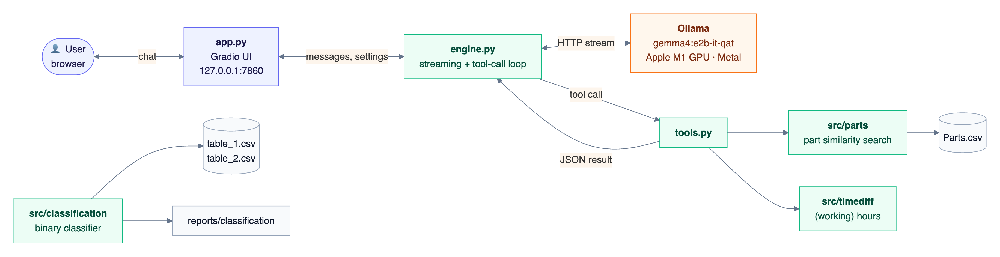
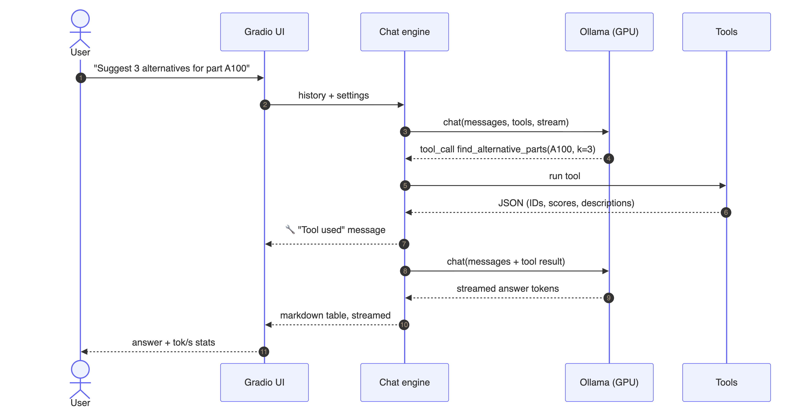
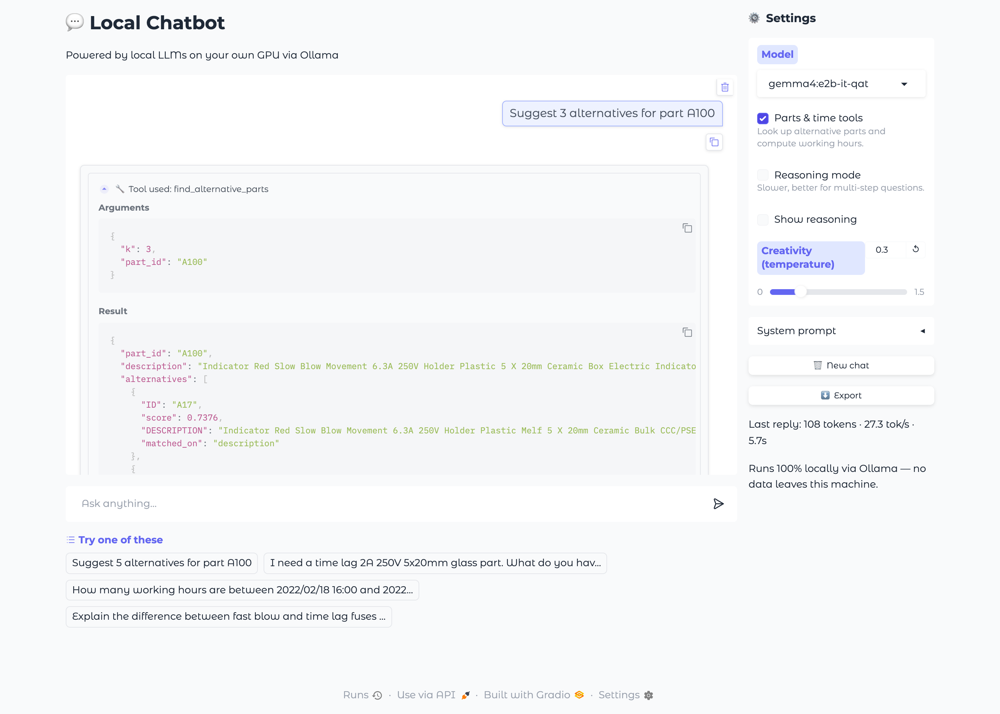
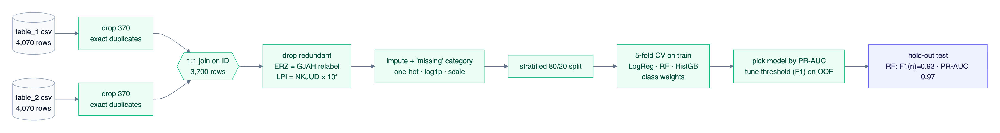
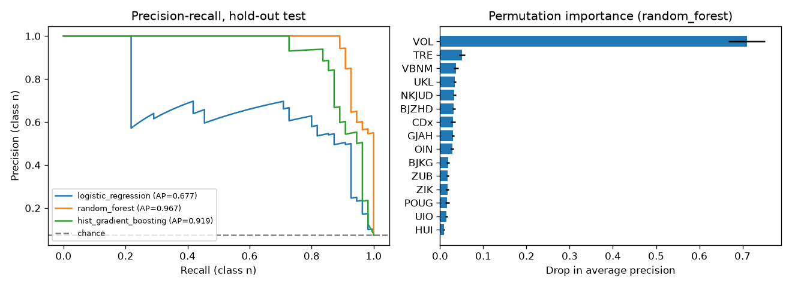
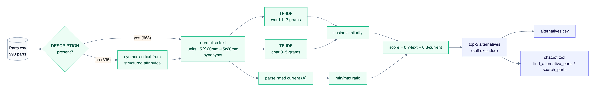
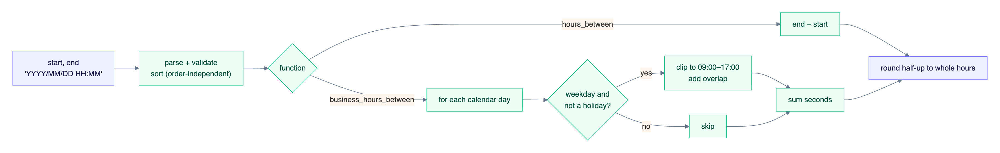

# Project Documentation

A fully local, GPU-accelerated LLM chatbot that can look up alternative parts and compute working hours.
The project also includes a binary classifier and the data analysis behind each component.


## Contents
1. [Overview](#1-overview)
2. [System architecture](#2-system-architecture)
3. [Machine and performance](#3-machine-and-performance)
4. [Setup and usage](#4-setup-and-usage)
5. [Chatbot](#5-chatbot)
6. [Binary classification](#6-binary-classification)
7. [Part similarity search](#7-part-similarity-search)
8. [Time calculations](#8-time-calculations)
9. [Testing and quality](#9-testing-and-quality)
10. [Project structure](#10-project-structure)
11. [Limitations and next steps](#11-limitations-and-next-steps)

---

## 1. Overview

| Component | What it does | Code |
|---|---|---|
| Chatbot | Local LLM chatbot with a Gradio UI, running on the GPU via Ollama | `app.py`, `src/chatbot/` |
| Binary classification | Predicts `Type` from two tables joined on `ID` | `src/classification/` |
| Part similarity search | Descriptive analysis plus 5 alternatives per part, available in the chatbot | `src/parts/` |
| Time calculations | Rounded hours between two timestamps, in total or working hours only (09:00–17:00, weekdays) | `src/timediff/` |

**Design principles**
- **Local first.** The model, the data and the UI all stay on the machine. The app binds to `127.0.0.1` and the git repository has no remote.
- **The LLM explains, the code computes.** Part IDs, scores and hour counts come from tested, deterministic Python functions that the model calls as *tools*. The model never invents them.
- **Transparent.** Every tool call is visible in the chat, with its arguments and its raw result.
- **Tested and reproducible.** There are 33 automated tests, pinned dependencies, and every report can be regenerated with one command.

---

## 2. System architecture



| Component | Responsibility |
|---|---|
| `app.py` | Gradio UI: chat panel, settings, examples, export. Holds no business logic. |
| `src/chatbot/engine.py` | Streams model output and runs the **tool-call loop** (up to 4 rounds). Does not depend on any UI. |
| `src/chatbot/tools.py` | Plain Python functions exposed to the LLM. Their docstrings become the tool schemas. |
| `src/parts/` | Part similarity: index, EDA, evaluation, batch export. |
| `src/timediff/` | Hour and working-hour calculations. |
| `src/classification/` | Classification: data cleaning and joining, model training and evaluation. |
| Ollama | Local model server (llama.cpp + Apple Metal) on `localhost:11434`. |

### How one chat request flows



1. The UI sends the conversation and the settings to the engine.
2. The engine streams a request to Ollama, together with the tool definitions.
3. If the model answers with a **tool call**, the engine runs the function, shows a "🔧 Tool used" message, and sends the result back to the model.
4. The model's final answer is streamed token by token into the chat, and the speed statistics are shown.

> Diagram sources are in [`docs/diagrams/`](diagrams) (Mermaid). They render directly on GitHub and can be re-exported to PNG.

---

## 3. Machine and performance

| | |
|---|---|
| Computer | Apple MacBook, **Apple M1**, macOS 26.7.1 |
| CPU | 8 cores (4 performance + 4 efficiency) |
| GPU | Apple M1 integrated GPU, **7 cores**, Metal 4 |
| Memory | **8 GB** unified memory (shared by CPU and GPU) |
| Software | Ollama 0.40.2 (llama.cpp, Metal backend) · Python 3.11.8 · Gradio 6.30 |

| Measurement | Value |
|---|---|
| GPU offload (`ollama ps`) | **100% GPU** |
| Model memory | ~1.7 GB |
| Generation speed | **~28–32 tokens/s** |
| Typical answer with a tool call | 5–12 s end to end |

The app shows tokens, tokens/s and wall time for every reply in the settings panel.

---

## 4. Setup and usage

```bash
# 1. Python environment
python3.11 -m venv .venv && source .venv/bin/activate
pip install -r requirements.txt

# 2. Local LLM runtime (macOS: `brew install ollama` or the Ollama app)
ollama serve &                        # skip if the Ollama app is running
ollama pull gemma4:e2b-it-qat         # chat model
ollama pull embeddinggemma-2:270m     # optional, only for the embedding comparison

# 3. Run
python app.py                         # chatbot -> http://127.0.0.1:7860
```

| Command | Purpose | Output |
|---|---|---|
| `python app.py` | Start the chatbot | http://127.0.0.1:7860 |
| `python -m src.classification.train` | Train and evaluate the classifiers (~1 min) | `reports/classification/` |
| `python -m src.parts.eda` | Descriptive analysis of the parts data | stdout (`reports/parts/eda.txt`) |
| `python -m src.parts.find_alternatives` | 5 alternatives for every part | `reports/parts/alternatives.csv` |
| `python -m src.parts.evaluate --embeddings` | Compare similarity variants | stdout (`reports/parts/evaluation.txt`) |
| `pytest` | Run all tests | 33 tests |

---

## 5. Chatbot

### 5.1 User interface



The UI is built for people who are not technical:
- **Streaming answers** in a familiar chat layout, with **example prompts** to start from.
- **Tool transparency.** Clicking "🔧 Tool used" shows exactly what was looked up and what came back.
- **Settings panel**:
  - model picker (any locally pulled Ollama model);
  - tools on/off;
  - *reasoning mode*, which can optionally be shown;
  - temperature;
  - editable system prompt.
- **New chat** and **Export** to Markdown; a copy button on every message.
- **Helpful errors.** If Ollama isn't running or no model is installed, the app says so and gives the exact command to fix it.
- **Private by default.** The app listens on localhost only, and the public share link is disabled.

### 5.2 Model choice: `gemma4:e2b-it-qat`
Google Gemma 4 "E2B": instruction-tuned, with quantisation-aware training (QAT) at 4-bit.

| Criterion | Why it fits |
|---|---|
| **Memory** | ~1.7 GB on the GPU, which leaves room for macOS and the browser on an 8 GB machine. 7–8 B models need ~5 GB and would swap. |
| **Tool calling** | Native `tools` capability in Ollama. In testing it reliably picked the right tool with correct arguments. Tool calling is what connects the chatbot to the part search. |
| **Quality per GB** | QAT keeps 4-bit quality close to full precision, better than post-hoc quantisation of a model of the same size. |
| **Speed** | ~30 tok/s on the M1 GPU, which feels interactive. |
| **Licence** | Apache 2.0. |

**Alternatives considered:**
- Llama 3.2 3B: weaker at tool use, older knowledge.
- Qwen 2.5 3B: comparable.
- Phi-3.5 mini: no native tool calling in Ollama.

The model can be switched in the UI without changing any code.

### 5.3 Package choices

| Package | Source | Why |
|---|---|---|
| **Ollama** + `ollama` client | github.com/ollama/ollama, PyPI (official) | The most widely used local LLM runtime. llama.cpp with first-class Metal support, one-command model management, and Python functions used directly as tools. |
| **Gradio** | PyPI | Chat component with streaming and collapsible tool/reasoning messages. Pure Python, and comes with an API client used in tests. Streamlit was prototyped first; Gradio's in-chat tool messages fit better. |
| pandas, NumPy, scikit-learn, matplotlib | PyPI | Standard, well-maintained data stack. |
| pytest | PyPI | Testing. |

Rejected alternatives:
- `llama-cpp-python`: more manual setup.
- `transformers` + PyTorch MPS: slower and too memory-hungry for 8 GB.
- MLX: Apple-only, weaker tool support.

### 5.4 Version control
The repository was created locally with `git init` on branch `main`, with **no remote**.
Work was committed in small steps (data → time calculations → classification → part search → engine → UI → tests → docs), and `git log` shows the history.
`.gitignore` excludes the virtualenv and caches.

---

## 6. Binary classification

Goal: predict the binary column `Type` from two tables that share the key `ID`.



### 6.1 Data findings
| # | Finding | Handling |
|---|---|---|
| 1 | Each table has 4,070 rows but only 3,700 IDs, because **370 rows are exact duplicates**. A naive join would be many-to-many and would leak rows between train and test. | Drop exact duplicates, then a **one-to-one** join on `ID` (validated). Result: 3,700 rows. |
| 2 | `ERZ` is a 1:1 relabelling of `GJAH`; `LPI` is exactly `NKJUD × 10,000`. | Drop both; 15 features remain. |
| 3 | **Imbalance:** 92.5% `y` vs 7.5% `n`. | `n` is the positive class; class weights; PR-AUC as the main metric; threshold tuned on out-of-fold predictions. |
| 4 | Missing values (e.g. `ZIK` 58%) and skewed numeric columns (`CDx`, `NKJUD`). | `missing` category for categoricals; median + missing indicator for numerics; log1p for the linear model. |

### 6.2 Results (hold-out test set, 740 rows)

| Model | CV PR-AUC | ROC-AUC | PR-AUC | F1 (n) | Balanced acc. |
|---|---|---|---|---|---|
| Majority baseline | 0.074 | 0.500 | 0.074 | 0.000 | 0.500 |
| Logistic regression | 0.629 | 0.951 | 0.677 | 0.688 | 0.879 |
| **Random forest ✔** | **0.932** | **0.996** | **0.967** | **0.932** | **0.936** |
| Hist. gradient boosting | 0.910 | 0.976 | 0.919 | 0.863 | 0.898 |



- The **random forest** found 48 of 55 `n` cases (recall 0.87) with **zero false alarms** (precision 1.00), for 99.1% accuracy.
- **`VOL` is the dominant feature:** the share of `n` is 42% when `VOL = f`, against 1.6% when `VOL = t`. `TRE`, `VBNM`, `UKL` and `NKJUD` follow.
- Tree models beat the linear model by a wide margin, so the signal comes from non-linear interactions between features.

---

## 7. Part similarity search

Goal: for every part in `Parts.csv`, find the 5 most similar alternatives based on its `DESCRIPTION`.

### 7.1 Descriptive analysis
- 998 parts (A1–A998) with 32 columns. Every structured column has 12–89% missing values.
- Descriptions are semi-structured spec strings, 43–205 characters long:
  `Indicator Red Fast Movement 1.6A 250V Holder Plastic 5 X 20mm Ceramic … Very Fast Blow, 1.6A, 250VAC, 1500A (IR) …`
- Main families: *Indicator Chip* (343, SMD), *Indicator Red* (171, 5×20 mm holder), *Indicator SubRed* (73).

### 7.2 Key findings and difficulties

| Finding | Evidence | Handling |
|---|---|---|
| **A third of the descriptions are missing** | 335 / 998 (33.6%) empty; 6–9 parts carry no information at all | Build a text from the structured attributes so these parts can still be matched; flag the match source (`description` / `attributes`); never recommend empty parts. |
| **Duplicates and self-contradictions** | 126 parts share a description with another ID. Current conflicts in 13 descriptions (`0.08A … 0.8A`), blow speed in 98 (*Very Fast … Fast Blow*). Each description looks like two concatenated sources. | Duplicates are valid alternatives (score ≈ 1). For the numeric comparison, use the first-stated value. Flag contradictions for data-quality review. |
| **Inconsistent formats; meaning carried by numbers** | `5 X 20mm` vs `5x20mm`, `Slow Blow` vs `Time Lag`, `SMD` vs `Surface Mount`. Bag-of-words treats `1.6A` and `2A` as unrelated tokens. | Normalise units and synonyms; add character n-grams; add an explicit **current-similarity** term. |

### 7.3 Solution



1. **Normalise** the text (units, dimensions, synonyms).
2. **TF-IDF** on word 1–2-grams **and** character 3–5-grams, then cosine similarity.
   - Word n-grams catch domain phrases.
   - Character n-grams cope with formatting variants and partial codes.
3. **Current similarity** = `min/max` of the parsed rated currents: 2 A vs 2 A scores 1.0, 1 A vs 2 A scores 0.5.
4. **Score = 0.7 × text + 0.3 × current**, with the part itself excluded, then the top 5.

**Why this approach:**
- It is precise on short, keyword-heavy technical text.
- It is deterministic and explainable.
- It builds the index in under a second, with no GPU or service needed.
- It handles numbers, which neither TF-IDF nor embeddings do well on their own.

### 7.4 Evaluation
There are no labelled true alternatives. As a proxy, I measured how often the top-5 alternatives share the query part's
structured attributes; the matcher does not see these columns for parts that have a description.

| Variant | Current | Characteristic | Mounting | Size | All match |
|---|---|---|---|---|---|
| Random | 0.04 | 0.29 | 0.46 | 0.12 | 0.00 |
| TF-IDF word + char | 0.48 | 0.73 | 0.97 | 0.73 | 0.12 |
| **TF-IDF + current (default)** | **0.69** | 0.63 | 0.93 | 0.62 | **0.14** |
| Semantic embeddings (embeddinggemma) | 0.30 | 0.82 | 0.97 | 0.79 | 0.09 |
| TF-IDF + embeddings + current | 0.76 | 0.59 | 0.91 | 0.58 | 0.15 |

- The best achievable "all match" (oracle) is only **0.23**. For most parts fewer than five genuine drop-in replacements exist, which is why every result carries a score.
- Embeddings capture the part *type* but ignore the ratings. Fusing them in adds little (+0.01) and requires a running embedding server, so the default stays lexical + current.

### 7.5 Chatbot integration (implemented)
- **Tools:** `find_alternative_parts(part_id, k)` and `search_parts(description, k)` are registered as LLM tools in `src/chatbot/tools.py`. The index is built once and cached.
- **Who decides:** the model decides when to call a tool. The tool returns JSON (IDs, scores, descriptions, match source), and the model presents the result as a table.
- **No invented part numbers:** the IDs come from the retrieval code, and the user can inspect the raw tool output in the chat.

Example prompts:
- *"Suggest 5 alternatives for part A100"*
- *"I need a time lag 2A 250V 5x20mm glass part"*
- *"Why is A17 a good replacement for A100?"*

---

## 8. Time calculations



```python
from src.timediff import hours_between, business_hours_between

hours_between("2022/02/15 00:05", "2022/02/15 01:00")            # 1
business_hours_between("2022/02/18 16:00", "2022/02/21 10:00")   # 2  (Fri 16–17 + Mon 9–10)
```

| Behaviour | Detail |
|---|---|
| Input | `YYYY/MM/DD HH:MM`; invalid input raises a clear `ValueError` |
| Argument order | Irrelevant; the absolute difference is returned |
| Rounding | To whole hours, **half up** (`ROUND_HALF_UP`). Python's `round()` would turn 2.5 into 2. |
| Working hours | Each day is clipped to 09:00–17:00, weekends are skipped, and the overlaps are summed *before* rounding |
| Extras | Configurable working window and an optional `holidays` list |

These functions are also available as chatbot tools, e.g. *"How many working hours are between …?"*.

---

## 9. Testing and quality

| Test file | Covers |
|---|---|
| `tests/test_timediff.py` | 21 cases: reference example, rounding edges, reversed order, overnight, weekends, full week, leap day, holidays, invalid input |
| `tests/test_parts.py` | normalisation, current parsing, ranking order, self-exclusion, parts without a description, free-text search |
| `tests/test_engine.py` | tool-call loop and error reporting, using a fake Ollama client |
| `tests/test_app.py` | Gradio handler: streaming, tool messages, empty input |

The engine and UI tests use a fake client, so `pytest` runs without Ollama or a GPU.
I also tested the running app end to end through `gradio_client` and in a real browser.

---

## 10. Project structure

```
.
├── app.py                      # Gradio chatbot
├── requirements.txt            # pinned dependencies
├── data/                       # Parts.csv, table_1.csv, table_2.csv
├── src/
│   ├── chatbot/
│   │   ├── engine.py           # streaming + tool-call loop (UI-independent)
│   │   └── tools.py            # functions exposed to the LLM
│   ├── classification/         # data.py, train.py
│   ├── parts/                  # similarity.py, eda.py, evaluate.py, find_alternatives.py
│   └── timediff/               # hour calculations
├── reports/
│   ├── classification/         # metrics.json, results.png
│   └── parts/                  # alternatives.csv, eda.txt, evaluation.txt
├── tests/                      # 33 pytest tests
└── docs/
    ├── DOCUMENTATION.md        # this file
    ├── diagrams/               # Mermaid sources
    └── images/                 # screenshots and rendered diagrams
```

---

## 11. Limitations and next steps

- **Chatbot:**
  - A 2 B-effective model can still phrase things imperfectly, which is why the facts come from tools.
  - Retrieval over documents (RAG) and conversation memory across sessions could be added.
- **Classification:**
  - hyperparameter search;
  - repeated CV for confidence intervals;
  - probability calibration if the scores are used as risks.
- **Part search:**
  - user-selectable hard filters (same mounting, voltage ≥ original);
  - parse voltage and breaking capacity;
  - a small set of pairs labelled by experts, to tune the weights properly.
- **Time calculations:** time zones, DST, and regional holiday calendars (e.g. the `holidays` package).
